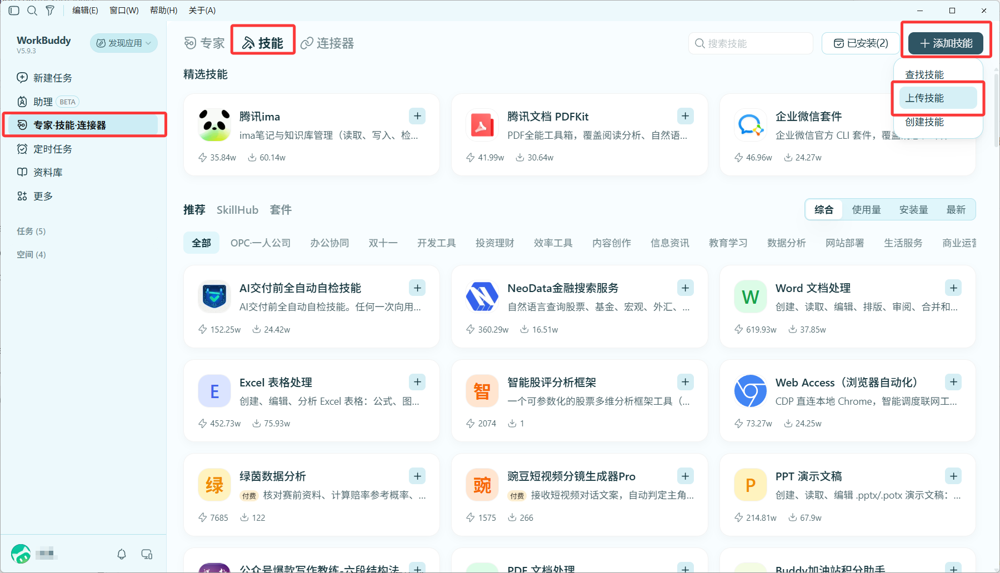
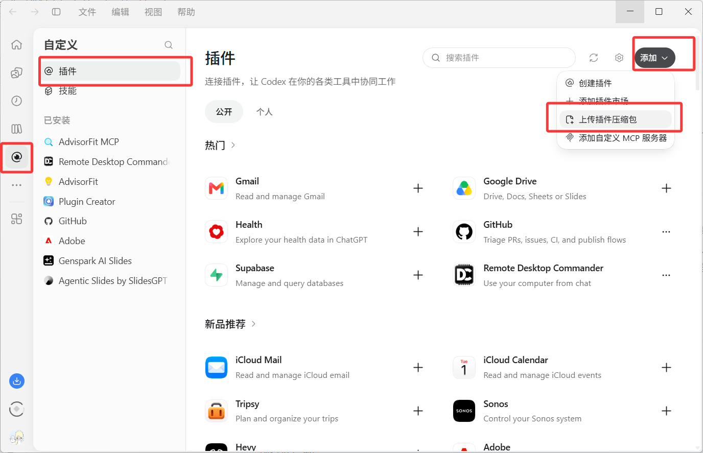
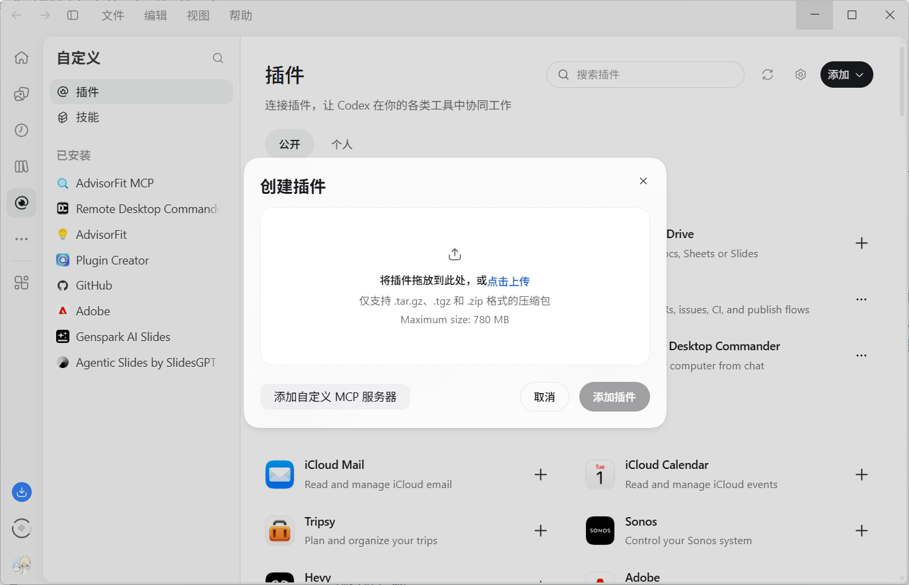

# 下载与安装

选择所用平台，下载对应ZIP并直接上传。无需下载整个仓库，也无需安装演示站依赖。

| 平台 | 必须下载的文件 | 文件如何使用 |
|---|---|---|
| WorkBuddy | [advisorfit-workbuddy-0.2.10.zip](https://github.com/dsSep/advisorfit-skill/releases/download/v0.2.10/advisorfit-workbuddy-0.2.10.zip) | 不解压，上传技能 |
| Codex桌面 | [advisorfit-skill-0.2.10.zip](https://github.com/dsSep/advisorfit-skill/releases/download/v0.2.10/advisorfit-skill-0.2.10.zip) | 不解压，上传插件压缩包 |
| ChatGPT | [advisorfit-skill-0.2.10.zip](https://github.com/dsSep/advisorfit-skill/releases/download/v0.2.10/advisorfit-skill-0.2.10.zip) | 在有相应入口的环境中导入插件 |

下面直接按图操作。截图界面可能随客户端版本变化。

## WorkBuddy

**下载：[advisorfit-workbuddy-0.2.10.zip](https://github.com/dsSep/advisorfit-skill/releases/download/v0.2.10/advisorfit-workbuddy-0.2.10.zip)**

下载完成后不解压，直接把这份ZIP上传到WorkBuddy。不要上传Codex插件包，也不要单独上传SKILL.md。

### 第1步：打开上传入口

左侧 **专家·技能·连接器** → 上方 **技能** → 右上角 **添加技能** → **上传技能**。



### 第2步：选择刚下载的ZIP

在「导入技能」窗口点击 **选择 ZIP 文件**，或把 `advisorfit-workbuddy-0.2.10.zip` 拖进去。按客户端提示确认导入和权限；不必勾选「非高风险自动安装」。


### 第3步：新建任务并使用

在「已安装」找到 **AdvisorFit 导师分析与套磁**，确认已启用；新建任务，在技能选择器中选择它（支持时也可输入 `/` 后选择）。然后提供脱敏背景和目标学校／导师：

> 使用AdvisorFit，这是我的简历，帮我分析这位导师，并写一封申请进组的邮件。

看到技能已安装只是第一步；任务中还应能读取AdvisorFit和相关研究／邮件参考。分析真实导师需要WorkBuddy当前可用的搜索、网页阅读和附件能力。本包不配置另一套模型密钥，不自动发送邮件。

## Codex

**下载：[advisorfit-skill-0.2.10.zip](https://github.com/dsSep/advisorfit-skill/releases/download/v0.2.10/advisorfit-skill-0.2.10.zip)**

下面是Codex桌面的插件压缩包安装方式。保留ZIP原样，不解压；不要使用WorkBuddy技能包。

### 第1步：选择「上传插件压缩包」

打开左侧 **自定义** → **插件**，点击右上角 **添加** → **上传插件压缩包**。



### 第2步：上传Codex插件包

在弹窗点击 **点击上传**，选择刚下载的 `advisorfit-skill-0.2.10.zip`，或直接拖入。文件读取完成后，按提示点击 **添加插件** 并确认。



### 第3步：新建聊天并调用

确认插件／技能列表中出现 **AdvisorFit**，新建聊天后选择它；在支持技能名称调用的环境中也可使用 `$advisorfit`：

> 使用AdvisorFit，结合我的脱敏简历分析这位导师，再准备申请进组邮件。

截图中的其他已安装插件不是AdvisorFit的依赖。无需配置MCP、连接器或额外API Key。界面入口可能随客户端版本变化。

<details>
<summary>没有「上传插件压缩包」入口：使用技能目录安装</summary>

在Codex中调用Skill Installer，并提供目录：

```text
https://github.com/dsSep/advisorfit-skill/tree/main/skills/advisorfit
```

也可解压Codex插件包，只把其中完整的 `skills/advisorfit/` 文件夹复制到项目的 `.agents/skills/advisorfit/` 或个人 `~/.agents/skills/advisorfit/`。保留SKILL.md、references和scripts，新开会话后使用 `$advisorfit`。这一备用方式需要解压；上面的桌面ZIP上传方式不需要。

</details>

## ChatGPT

**下载：[advisorfit-skill-0.2.10.zip](https://github.com/dsSep/advisorfit-skill/releases/download/v0.2.10/advisorfit-skill-0.2.10.zip)**

在支持自定义插件导入的ChatGPT环境中上传这份完整ZIP，确认安装后新建聊天并选择AdvisorFit。具体入口与权限依账户、客户端和工作区而异；如果没有插件导入入口，普通附件上传不等于原生安装Skill。可以改用上面的WorkBuddy或Codex步骤。

## 安装后还不能使用？

- **没有找到AdvisorFit**：确认下载的文件名和平台对应；在已安装列表启用后新建任务。
- **提示格式不支持**：上传原ZIP，不要上传GitHub的Source code、截图、单独SKILL.md或另一平台的包。
- **不能联网或读PDF**：这是宿主能力和权限问题。提供脱敏纯文本、官方主页及论文材料，要求标明实际阅读范围。
- **更新后仍像旧版**：按同一平台下载并导入新版本，然后新建任务；GitHub更新不会自动更新本机安装。

## 更新与核对

发布包附有SHA256校验文件，见[版本与校验值](https://github.com/dsSep/advisorfit-skill/releases/tag/v0.2.10)。图示教程更新不代表重新验证了所有客户端和账户。

图示操作依据客户端界面与官方说明：[WorkBuddy技能](https://www.codebuddy.cn/docs/workbuddy/From-Beginner-to-Expert-Guide/Function-Description/Skills-Market)、[OpenAI插件打包与本地测试](https://developers.openai.com/plugins/build/plugins)。
