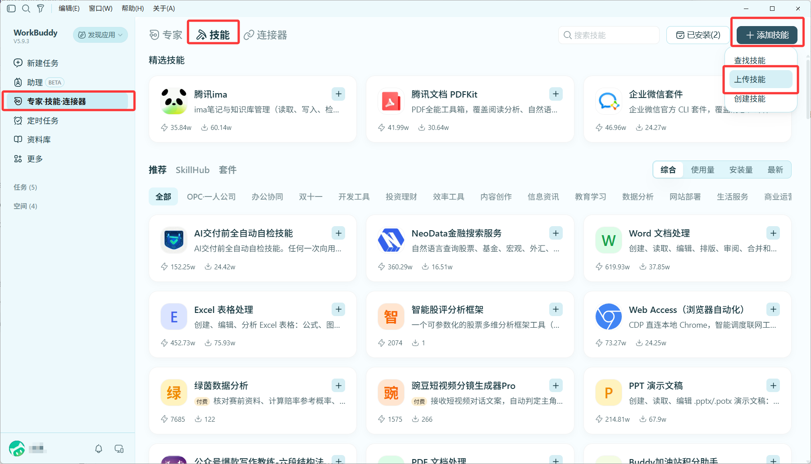
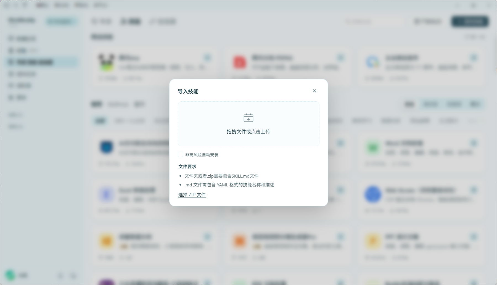

# WorkBuddy安装图示

**下载：[advisorfit-workbuddy-0.2.10.zip](https://github.com/dsSep/advisorfit-skill/releases/download/v0.2.10/advisorfit-workbuddy-0.2.10.zip)**

下载完成后不解压，直接把这份ZIP上传到WorkBuddy。不要上传Codex插件包，也不要单独上传SKILL.md。

### 第1步：打开上传入口

左侧 **专家·技能·连接器** → 上方 **技能** → 右上角 **添加技能** → **上传技能**。

### 第2步：选择刚下载的ZIP

在「导入技能」窗口点击 **选择 ZIP 文件**，或把 `advisorfit-workbuddy-0.2.10.zip` 拖进去。按客户端提示确认导入和权限；不必勾选「非高风险自动安装」。

### 第3步：新建任务并使用

在「已安装」找到 **AdvisorFit 导师分析与套磁**，确认已启用；新建任务，在技能选择器中选择它（支持时也可输入 `/` 后选择）。然后提供脱敏背景和目标学校／导师：

> 使用AdvisorFit，这是我的简历，帮我分析这位导师，并写一封申请进组的邮件。

看到技能已安装只是第一步；任务中还应能读取AdvisorFit和相关研究／邮件参考。分析真实导师需要WorkBuddy当前可用的搜索、网页阅读和附件能力。本包不配置另一套模型密钥，不自动发送邮件。

更新时下载同平台的新版本ZIP，重新导入并新建任务。请使用虚构或脱敏简历；分享前检查附件、输出和宿主记忆。本技能不能关闭宿主记录。
